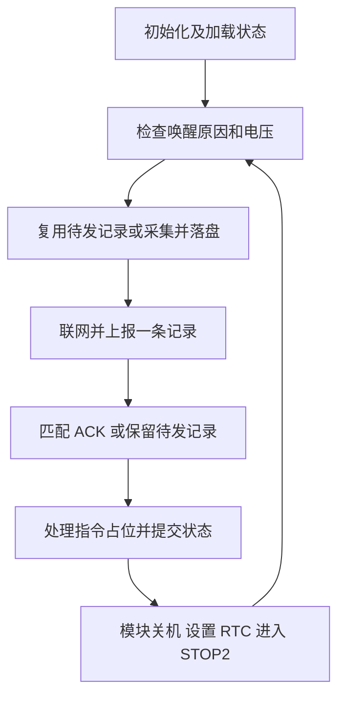

# STM32L476 单次通信任务

## 本版完成的工作

选择 STM32L476RGT6，裸机事件轮询，不引入 RTOS。通信模块假设为带标准 AT 固件的 Quectel EC200U，通过 USART1 连接。系统以 MSI 4 MHz 工作，RTC 优先使用 LSE，LSE 启动失败时退回 LSI。

一次任务按以下顺序执行：

1. 检查电池电压。低电量或 ADC 错误时保持通信模块关闭。
2. 存在待确认记录时先补发该记录。没有待发记录时采集电压、唤醒原因和启动次数，分配序号并可靠落盘。
3. 打开模块电源，驱动 PWRKEY，检查 SIM 和 LTE 注册，激活数据连接并建立 TCP Socket。
4. 发送 `DATA`，通过 `QIRD` 读取服务器结果。只有匹配设备 ID 与序号的业务 `ACK` 才能清除待发记录。
5. 读取短暂指令窗口，处理已完整接收的只读或不支持命令。保存状态并请求模块正常关机。
6. 关闭供电及串口，设置 RTC 定时器，进入 STOP2。RTC 或 PB12 上升沿使设备再次执行任务。

当前发送的是真实 ADC 电压及运行状态，**尚未实现 GNSS 获取经纬度**。GNSS 供电、串口引脚和驱动接入位置已保留。



## 源码入口

| 文件 | 职责 |
|---|---|
| `src/main.c` | 初始化、任务循环、安排下一次唤醒 |
| `src/board_stm32l476.c` | 时钟、GPIO、ADC、UART、RTC、Flash、STOP2 |
| `src/app.c` | 单次任务状态机、缓存保留和 ACK 提交 |
| `src/modem_ec200u.c` | 异步 AT 状态机、UART 环形接收、QIRD 长度解析 |
| `src/journal.c` | 两页 Flash 的双副本提交、CRC、掉电恢复 |
| `src/protocol.c` | TCP 流分帧、ACK 校验、命令暂存 |
| `src/commands.c` | 预留指令分发表，当前只有只读 PING 占位 |
| `ld/stm32l476rg.ld` | 应用、指令扩展、配置和状态区划分 |
| `tools/test_server.py` | SQLite 持久保存后再 ACK 的测试服务器 |

## 构建

需要 Python 3.10+ 与 `arm-none-eabi-gcc`。不用安装 make 或 CMake。

在仓库根目录执行：

```sh
python firmware/tools/fetch_vendor.py
python firmware/tools/build.py
```

依赖固定为 STM32CubeL4 v1.18.2 使用的 HAL 与设备组件提交，CMSIS Core 使用 5.9.0。下载的代码保存在 `firmware/vendor`，保留上游许可证，不提交到仓库。可用 `--hal-dir`、`--device-dir`、`--core-dir` 指向已有依赖，用 `--cc` 指定编译器路径。

构建产物为 `firmware/build/gps.elf`、`gps.hex`、`gps.map`。用 STM32CubeProgrammer 或 ST-LINK 将 **HEX** 下载到所选 STM32L476RG，不做整片擦除以外的自动烧录操作。命令表位于高地址保留区，因此使用 HEX 能保留稀疏地址信息。

## 配置 APN 和服务器

复制 `firmware/config/local_config.example.h` 为 `local_config.h`，填入实际 APN、可达服务器地址和端口，然后运行：

```sh
python firmware/tools/build.py --config firmware/config/local_config.h
```

本地配置已加入忽略列表，不上传 SIM 信息和服务器凭据。默认 APN 为空、服务器为文档占位地址，固件会保留待发记录并跳过联网，避免把示例参数当作可用网络配置。

`APP_INTERVAL_SECONDS` 默认 3600，表示**本次任务结束后等待的秒数**，允许 1-65535。示例本地配置设为 60 秒以便实验。`APP_LOW_BATTERY_MV` 的 2800 mV 只是待校准的演示门限，不能直接套用到所有一次电池。

## 测试服务器

```sh
python firmware/tools/test_server.py --host 127.0.0.1 --port 9000
```

本机地址只供电脑自身测试。蜂窝模块需要能访问的服务器 IP / DNS、开放的 TCP 端口以及正确的防火墙/NAT 配置。受控联调时可在自己的测试服务器上使用 `--host 0.0.0.0`；本程序是明文测试协议，生产部署前必须增加认证与 TLS。

`--drop-ack` 用来模拟“服务器已经保存，但回执丢失”。`--send-ping` 会随 ACK 发送只读测试命令。客户端本版不回传命令执行结果，详情见 [协议文档](docs/protocol.md)。

## 软件测试

```sh
python firmware/tools/test.py --cc gcc
python -m unittest discover -s firmware/tests -p test_server.py -v
```

C 测试用内存模拟 Flash 和模块，不访问真实设备。覆盖完整任务、八个 Flash 写入断点、CRC 损坏、重启补发、错误 ACK、电量不足、任务总超时、毫秒计数回绕、接收溢出及超大 QIRD。Python 测试覆盖解析、去重、冲突拒绝和实际 localhost TCP 分片收发。

GitHub Actions 同时执行软件测试、下载固定驱动并交叉编译。软件测试通过不等于实机已通过，首次连接硬件请按 [联调说明](docs/bringup.md) 操作。
